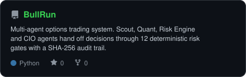
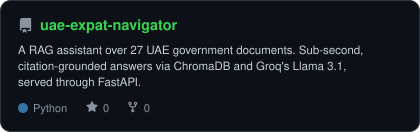
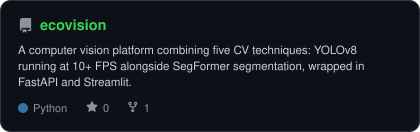
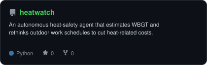
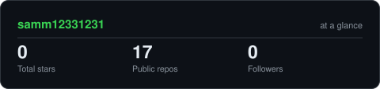

<div align="center">

<!-- Optional portrait: uncomment after generating assets/portrait.svg -->
<!--  -->

<br>

<a href="https://github.com/samm12331231">
  
</a>

<p>
  <strong>Computer Science graduate · Big Data & AI · UAE</strong>
</p>

<a href="https://linkedin.com/in/samyukth-kalathil-b17234274"></a>
<a href="mailto:pksam234@gmail.com"></a>
<a href="https://github.com/samm12331231?tab=repositories"></a>

<br><br>


</div>

---

## `~/` whoami

```console
$ cat about.txt
```

Hi, I'm **Samyukth Kalathil**, a **University of Wollongong Computer Science graduate** specializing in **Big Data & Artificial Intelligence**.

I build AI applications that connect models with data, tools, and useful interfaces—from document-grounded assistants and agent workflows to computer-vision applications.

- **Currently:** working on AI and robotics at **Ibtikar Robotics**.
- **Public work:** exploring RAG, AI agents, computer vision, and data-driven applications.
- **Learning:** evaluation, reliable backend workflows, and better ways to handle model and system failures.
- **What keeps me building:** taking an idea beyond a notebook and turning it into something people can interact with.

<br>

<div align="center">

## `~/` toolbox


<br><br>

<sub>Tools I use and explore across my projects.</sub>

</div>

---

## `~/` selected work

Four public projects across AI agents, retrieval, computer vision, and environmental monitoring.

<table>
<tr>
<td width="50%" valign="top">
  <a href="https://github.com/samm12331231/BullRun">
    <picture>
      <source media="(prefers-color-scheme: dark)" srcset="assets/card-BullRun-dark.svg">
      <source media="(prefers-color-scheme: light)" srcset="assets/card-BullRun-light.svg">
      
    </picture>
  </a>
  <p><strong>Agent workflows with explicit controls.</strong> An experimental options paper-trading system combining deterministic risk checks, human approval, and plain-language explanations.</p>
  <p><code>Python</code> <code>Next.js</code> <code>Alpaca</code></p>
</td>
<td width="50%" valign="top">
  <a href="https://github.com/samm12331231/uae-expat-navigator">
    <picture>
      <source media="(prefers-color-scheme: dark)" srcset="assets/card-uae-expat-navigator-dark.svg">
      <source media="(prefers-color-scheme: light)" srcset="assets/card-uae-expat-navigator-light.svg">
      
    </picture>
  </a>
  <p><strong>Answers grounded in official documents.</strong> A UAE government-service assistant using PDF retrieval, eligibility checks, and fee-calculation tools.</p>
  <p><code>Python</code> <code>LangChain</code> <code>ChromaDB</code> <code>FastAPI</code></p>
</td>
</tr>
<tr>
<td width="50%" valign="top">
  <a href="https://github.com/samm12331231/ecovision">
    <picture>
      <source media="(prefers-color-scheme: dark)" srcset="assets/card-ecovision-dark.svg">
      <source media="(prefers-color-scheme: light)" srcset="assets/card-ecovision-light.svg">
      
    </picture>
  </a>
  <p><strong>Computer vision for environmental imagery.</strong> Land-cover segmentation, object detection, and change detection for satellite and aerial images, presented in an interactive dashboard.</p>
  <p><code>PyTorch</code> <code>SegFormer</code> <code>YOLOv8</code> <code>OpenCV</code> <code>FastAPI</code></p>
</td>
<td width="50%" valign="top">
  <a href="https://github.com/samm12331231/heatwatch">
    <picture>
      <source media="(prefers-color-scheme: dark)" srcset="assets/card-heatwatch-dark.svg">
      <source media="(prefers-color-scheme: light)" srcset="assets/card-heatwatch-light.svg">
      
    </picture>
  </a>
  <p><strong>Exploring heat-risk monitoring.</strong> A hackathon prototype for youth athletics, combining weather-based estimates, scheduling recommendations, and an auditable decision trail. Includes a historical replay demo.</p>
  <p><code>Python</code> <code>Streamlit</code> <code>SQLite</code></p>
</td>
</tr>
</table>

<p align="center">
  <a href="https://github.com/samm12331231?tab=repositories"><strong>Explore all public repositories →</strong></a>
</p>

---

<div align="center">

## `~/` skill radar

<table>
<tr>
<td width="50%" align="center" valign="middle">

<picture>
  <source media="(prefers-color-scheme: dark)" srcset="assets/radar-dark.svg">
  <source media="(prefers-color-scheme: light)" srcset="assets/radar-light.svg">
  
</picture>

<sub>Self-assessed areas of focus.</sub>

</td>
<td width="50%" align="center" valign="middle">

<picture>
  <source media="(prefers-color-scheme: dark)" srcset="assets/radar-langs-dark.svg">
  <source media="(prefers-color-scheme: light)" srcset="assets/radar-langs-light.svg">
  
</picture>

<sub>Language distribution across repositories.</sub>

</td>
</tr>
</table>

</div>

---

<div align="center">

## `~/` contribution calendar


<br><br>

<picture>
  <source media="(prefers-color-scheme: dark)" srcset="https://raw.githubusercontent.com/samm12331231/samm12331231/output/snake-dark.svg">
  <source media="(prefers-color-scheme: light)" srcset="https://raw.githubusercontent.com/samm12331231/samm12331231/output/snake.svg">
  
</picture>

</div>

---

<div align="center">

## `~/` the numbers

<picture>
  <source media="(prefers-color-scheme: dark)" srcset="assets/card-stats-dark.svg">
  <source media="(prefers-color-scheme: light)" srcset="assets/card-stats-light.svg">
  
</picture>

<br><br>


<br><br>


</div>

---

## `~/` next

```console
$ cat next.txt
```

I'm exploring how to make AI applications more reliable: evaluating their outputs, recovering from failures, and designing workflows that people can understand.

Interested in **AI engineering, applied machine learning, and robotics software**—and always happy to talk about an interesting project.

<div align="center">

<br>

<a href="https://linkedin.com/in/samyukth-kalathil-b17234274"><strong>Let's connect</strong></a>

<br><br>

<sub><code>build → test → learn → improve</code></sub>

<br><br>

<sub><code>01100010 01110101 01101001 01101100 01100100 00100000 01110011 01101111 01101101 01100101 01110100 01101000 01101001 01101110 01100111 00100000 01110111 01101111 01110010 01110100 01101000 00100000 01101100 01101111 01101111 01101011 01101001 01101110 01100111</code></sub>

</div>
